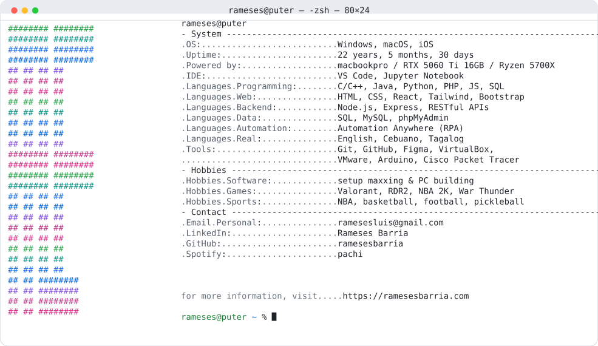

<a href="https://github.com/ramesesbarria/ramesesbarria">
  <picture>
    <source media="(prefers-color-scheme: dark)" srcset="https://raw.githubusercontent.com/ramesesbarria/ramesesbarria/6174f2ad33d81d6a75441f924c7866a2dd258005/dark_mode.svg">
    
  </picture>
</a>
